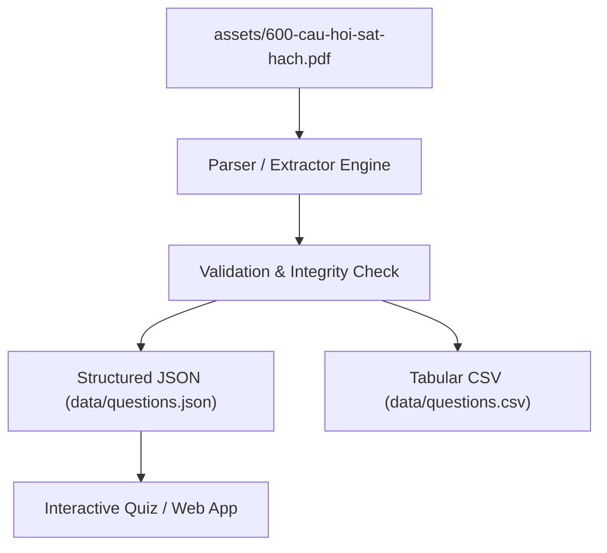

# Architecture Overview (tdytools-gplx)

## 1. System Context
`tdytools-gplx` là một công cụ độc lập trong bộ công cụ `tdytools`, tập trung vào dữ liệu câu hỏi sát hạch bằng lái xe (GPLX).

## 2. Các phân hệ chính
1. **Source Ingestion**:
   - `assets/600-cau-hoi-sat-hach.pdf`: File gốc 600 câu hỏi kèm hình ảnh sa hình và biển báo.
2. **Parser & Extractor**:
   - Tách text, metadata, nhóm câu hỏi (Chương 1 đến Chương 8).
   - Tách hình ảnh minh hoạ cho các câu hỏi sa hình và biển báo.
3. **Data Storage & Export**:
   - Dữ liệu chuẩn lưu tại `data/` dưới dạng JSON và CSV.
4. **App / Runner (Future)**:
   - Module luyện thi trắc nghiệm theo đề chuẩn (Hạng B1, B2, C, D, E, F) hoặc ôn tập theo chương.
