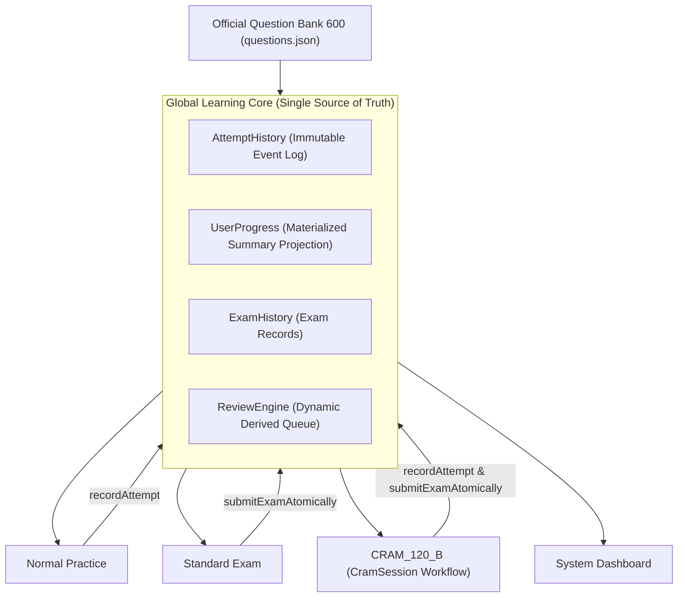

# Kiến Trúc Tích Hợp Dữ Liệu Hai Chiều CRAM_120_B & Global Learning State

## 1. Nguyên Tắc Cốt Lõi (Core Invariant)
> **CRAM_120_B là một learning session (`mode = 'cram-120'`), không phải một profile dữ liệu độc lập. Mọi kết quả học tập trong Cram120 chảy trực tiếp, tức thì và hai chiều vào Global Learning State (`UserProgress` + `AttemptHistory` + `ExamHistory`).**

Không tạo `CramProgress`, `CramMastery` hay `CramReviewQueue` song song. Cram120 chỉ đóng vai trò là một **Accelerator Layer** trên cùng một Learning Core thống nhất.



---

## 2. Các Thành Phần Dữ Liệu

### A. Taxonomy Chuẩn Hóa
- **`ActivityMode`**: `'practice' | 'critical-review' | 'exam' | 'cram-120'`
- **`AttemptRecord`**:
  ```typescript
  export interface AttemptRecord {
    id: string;
    questionId: string;
    selectedOptionId: number;
    isCorrect: boolean;
    mode: ActivityMode;
    sessionId?: string; // Bắt buộc khi mode === 'cram-120'
    examId?: string;    // Bắt buộc khi attempt nằm trong Exam stage
    timestamp: string;
    timeSpentMs?: number;
  }
  ```
- **`ExamRecord`**:
  - `mode: 'exam' | 'cram-120'`
  - `examType: 'random' | 'fixed'`

### B. Dexie.js Schema v3
```typescript
this.version(3).stores({
  progress: 'questionId, status, consecutiveCorrect, isBookmarked, lastAttemptAt',
  examHistory: 'id, profileId, completedAt, score, passed, mode, examType',
  activeSession: 'examId, profileId, startedAt',
  cramSessions: 'id, status, startedAt, currentStage',
  attempts: 'id, questionId, timestamp, mode, sessionId, examId',
  settings: 'key'
});
```

---

## 3. Bất Biến Kỹ Thuật (Engineering Invariants)

1. **Official Question Bank là Thước Đo Chân Lý (Official Truth)**:
   - `recordAttempt()` tự tra cứu `Question` trong `questions.json` và so khớp `selectedOptionId === correctOption.id`. UI không quyết định `isCorrect`.
2. **Immutable Event Log & Materialized Summary**:
   - Bảng `attempts` chỉ append, không update.
   - `UserProgress` là hình chiếu tổng hợp cập nhật tức thì. Hàm `rebuildProgressFromAttempts()` có thể tái tạo 100% `UserProgress` từ lịch sử.
3. **Atomic Multi-Entity Transactions**:
   - Trả lời câu hỏi: ghi `attempts` + cập nhật `userProgress` trong 1 transaction.
   - Nộp bài thi (`submitExamAtomically`): ghi `ExamRecord` + các `AttemptRecord` (chỉ ghi câu user thực sự trả lời) + `UserProgress` trong 1 transaction duy nhất.
4. **Dynamic Derived Review Queue**:
   - `getQuestionsNeedingReview()` tính động: `status === 'review' || consecutiveIncorrect > 0 || (isCritical && status !== 'mastered')`.
   - Đúng 2 lần liên tiếp xuyên mode (`consecutiveCorrect >= 2`) $\rightarrow$ `mastered` và câu tự động biến mất khỏi hàng đợi cần ôn.
5. **Baseline Snapshot & Before / After Delta**:
   - Khi bắt đầu phiên, chụp ảnh snapshot `CramBaseline` (`criticalMastered`, `masteredCount`, `reviewCount`, `readinessLevel`).
   - Màn hình kết quả so sánh Baseline với Current State để phản ánh chính xác sự tiến bộ thực tế.
6. **Sao Lưu Toàn Vẹn (Backup Schema v2)**:
   - `BackupData` có `schemaVersion: 2`, lưu đầy đủ cả `attempts`. Import hỗ trợ tương thích ngược schema 1.
